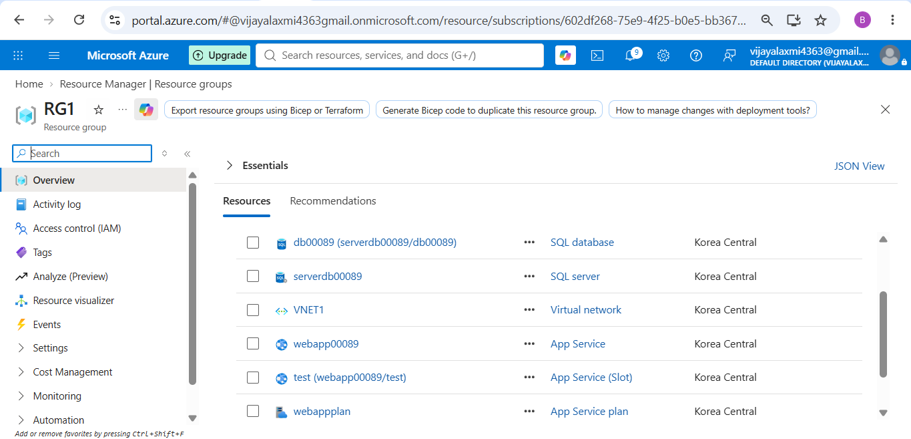
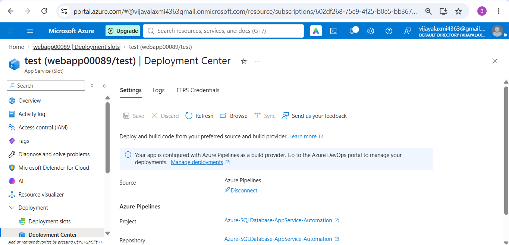
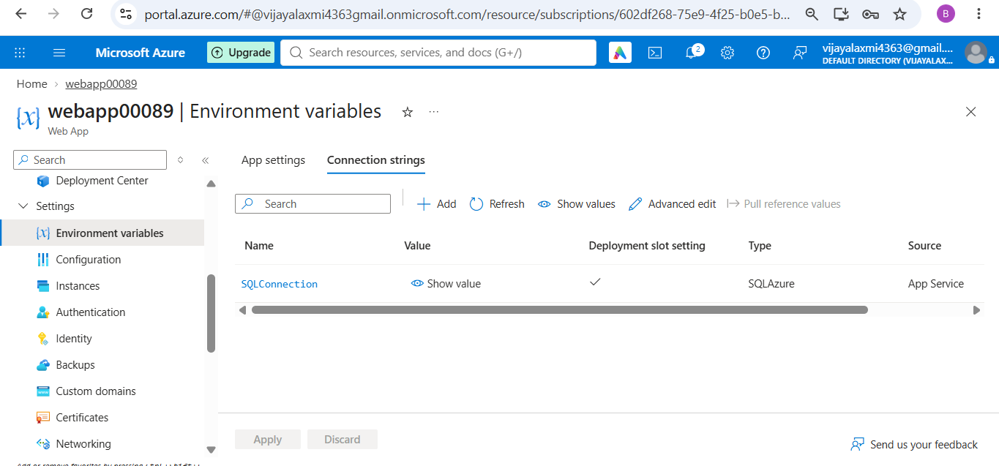
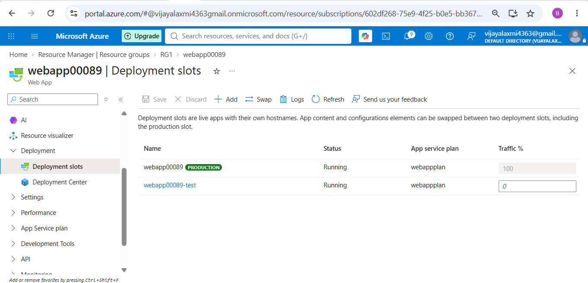
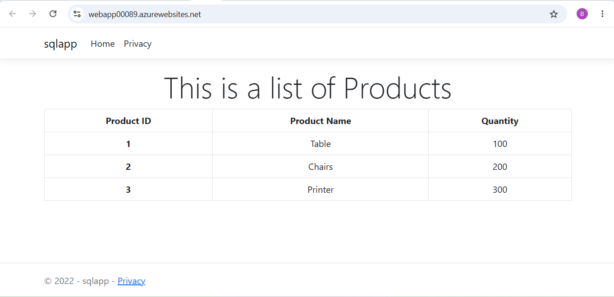
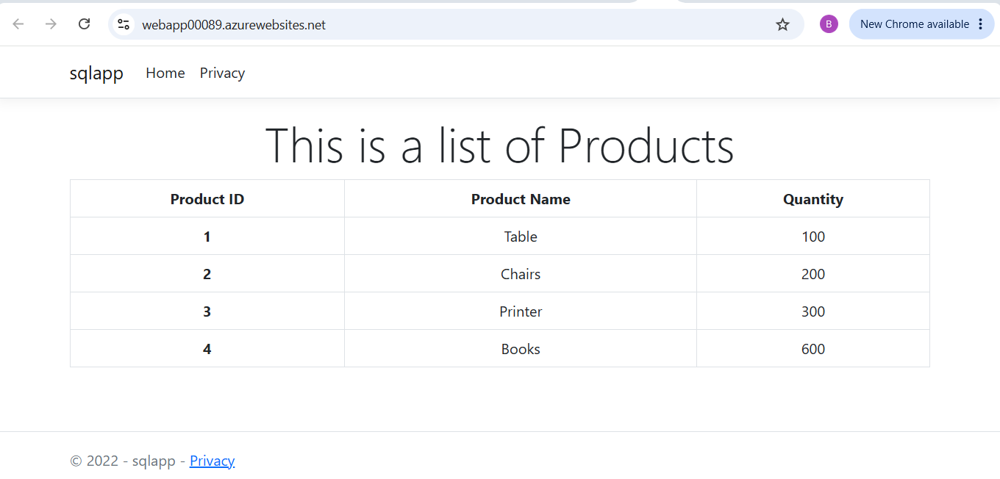

App deployment on Azure App Service and Azure DB - Automation.

Deployed RG, VNET, App service, App service plan, Azure DB server, Azure DB using terraform. \

Azure-Pipelines.yaml file: \
Test, Prod environments. \
Provision infrastructure using terraform. \
SQL script for database automation. \
Deploy app to Test slot. \
 \
Add approval in Prod environment. \
Deploy app to Prod slot once approved. 

App:  \

Added new data in database. result:

